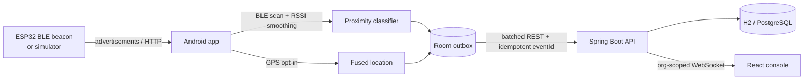
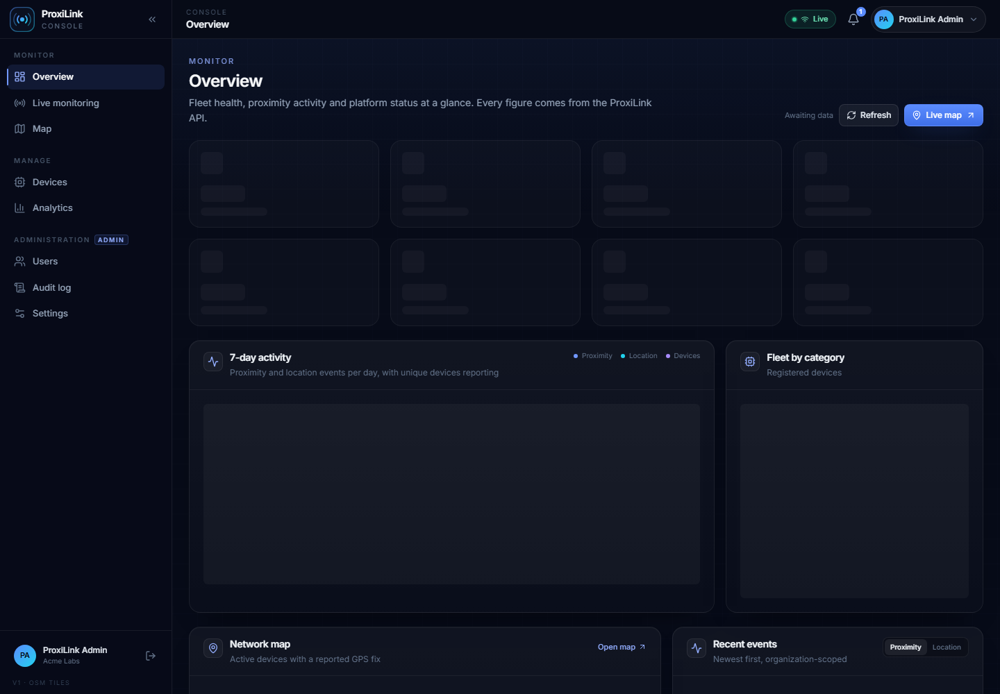
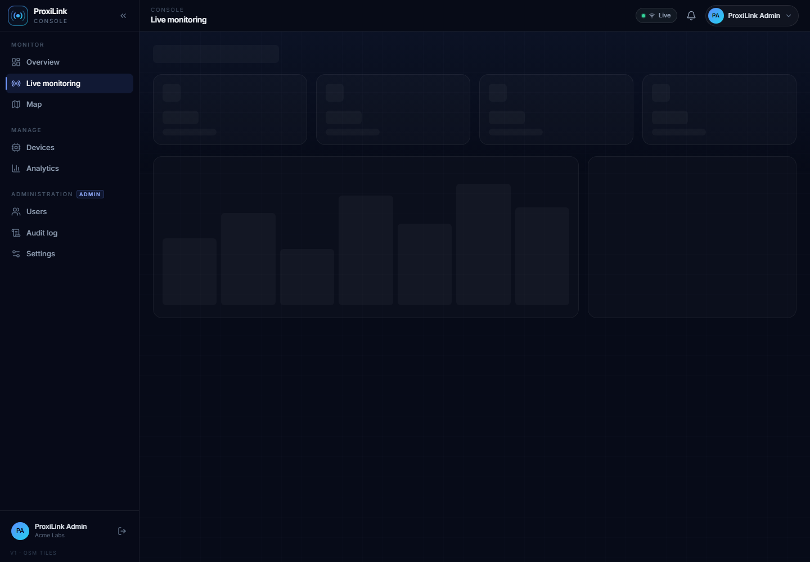
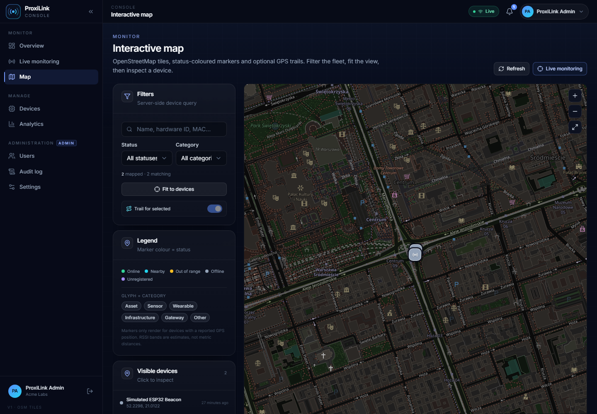
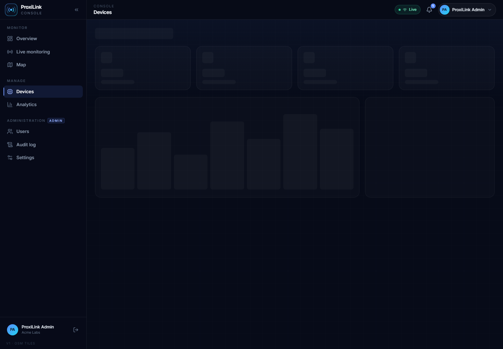
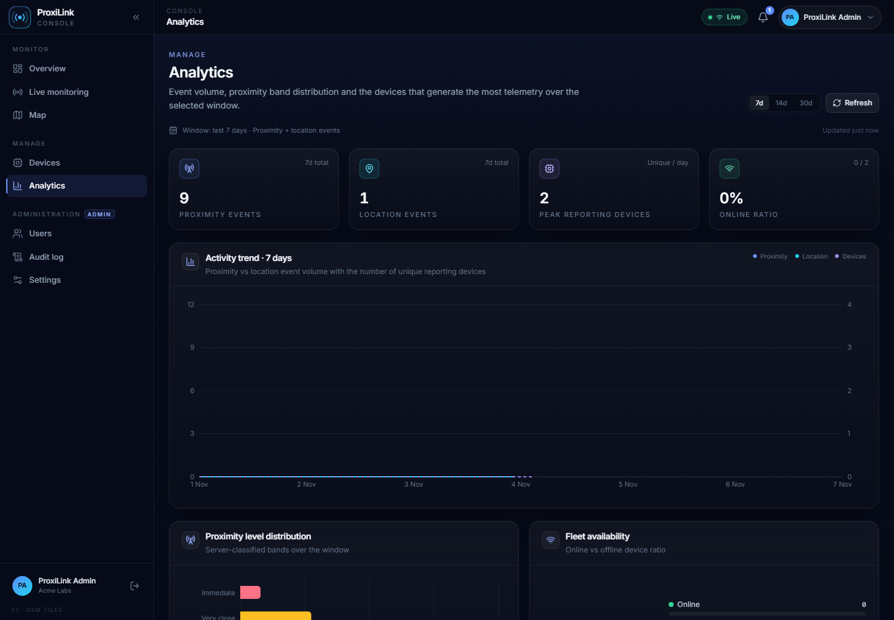
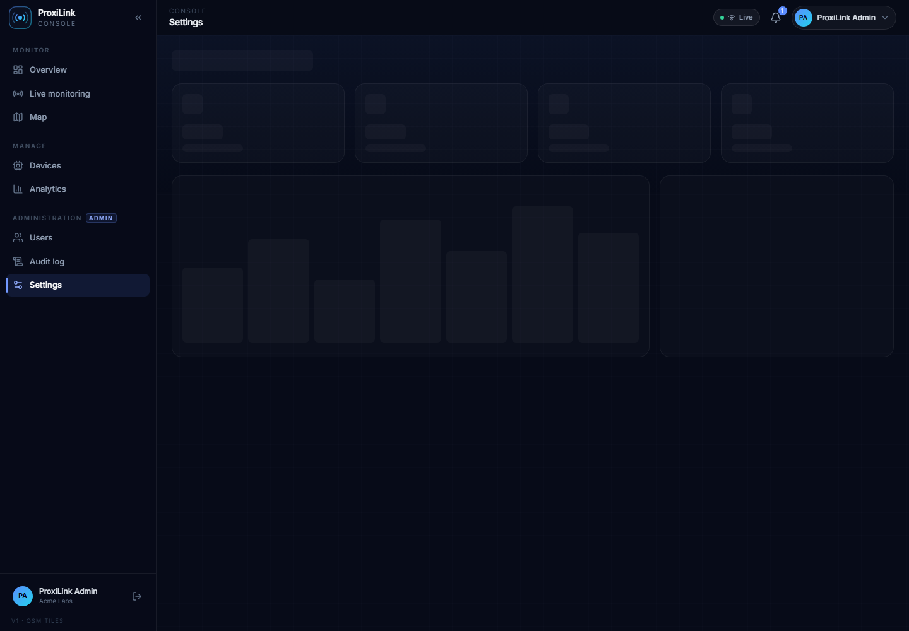

# ProxiLink

**Intelligent location-based and IoT proximity monitoring platform.**

ProxiLink turns BLE advertisements and GPS fixes into an operational picture:
an Android app scans for registered beacons, estimates proximity from RSSI,
queues events offline, and streams them to a Spring Boot backend; an
administrator console shows live proximity, devices, maps, analytics and audit
trails for one organization.

> **Data honesty.** RSSI is a noisy radio measurement, not a distance sensor.
> Every distance in the product is labelled an estimate. The development
> environment had no Bluetooth beacon and no GPS hardware, so the end-to-end demo
> uses `tools/simulator.py`, whose events are explicitly tagged
> `metadata.simulated=true`. No hardware results are invented.

## Repository layout

| Path | Contents |
| --- | --- |
| `android-app/` | Kotlin + Jetpack Compose Android client (BLE scanner, GPS, Room outbox, WorkManager, foreground monitoring service) |
| `backend/` | Kotlin Spring Boot REST + WebSocket API, JWT/RBAC, Flyway, H2 (dev) / PostgreSQL (prod) |
| `admin-dashboard/` | React 19 + TypeScript + Tailwind operations console |
| `iot-hardware/esp32-ble-beacon/` | Reference ESP32 BLE beacon firmware (not flashed/verified) |
| `tools/simulator.py` | Stdlib-only event simulator with a clear simulation banner |
| `documentation/` | SRS, architecture, API contract, ER model, networking, permissions, hardware, deployment, testing, screenshots |
| `tests/browser-verify.mjs` | Headless-Chrome verification and screenshot script |
| `docker-compose.yml` | PostgreSQL + Redis + backend + dashboard stack |

## Architecture



See [documentation/architecture.md](documentation/architecture.md) and
[documentation/networking.md](documentation/networking.md) for components,
event flow, failure modes and the WebSocket protocol.

## Features

**Android**
- Version-aware permissions (Android 8–16), explicit rationale, graceful denial,
  no silent scanning.
- Foreground monitoring service (`connectedDevice`) with a persistent stop
  action; the user starts and stops scanning.
- Median-of-5 + EMA RSSI smoothing, configurable dBm bands, log-distance estimate
  clearly marked as an estimate.
- Room outbox with client-generated UUIDs, batching, retry/backoff, idempotent
  replay; opt-in location sharing.
- Simulation mode that runs through the same pipeline and is visibly labelled.
- 19 Compose destinations: splash, onboarding, login/register, dashboard, scan,
  nearby, device details, register device, monitoring, map, location and
  proximity history, notifications, profile, settings, privacy, network.

**Backend**
- JWT access/refresh with rotation and single-use refresh tokens (SHA-256 hashes
  stored), BCrypt(12) passwords, role-based access (`ADMIN`/`USER`).
- Organization scoping on every read and write; administrators may cross
  organizations.
- Device registry, identification, status history, proximity/location event
  ingestion, notifications, audit log, settings, dashboard analytics.
- Bean validation, pagination caps, per-IP rate limiting, idempotent ingestion,
  Flyway migrations, OpenAPI/Swagger.
- Production startup guards: no boot without a proper JWT secret, explicit CORS
  and WebSocket origins; optional first-admin bootstrap.

**Dashboard**
- Overview, live monitoring (WebSocket), interactive OpenStreetMap, device
  registry, analytics, profile and admin users/audit/settings.
- Origin-relative API, single-flight token refresh, reconnect with backoff,
  skeleton/error/empty states, responsive layout and a 403 page.

**Hardware and simulation**
- ESP32 sketch advertises the ProxiLink service and exposes GATT telemetry.
- `tools/simulator.py` produces realistic RSSI walks against the real API and is
  labelled simulation mode in its output and in event metadata.

## Quick start

### 1. Backend (JDK 21)

```bash
cd backend
./gradlew bootRun          # http://localhost:8080
```

The `dev` profile seeds two demo accounts in organization **Acme Labs** and uses
an H2 file database at `backend/data/`.

| Role | Email | Password |
| --- | --- | --- |
| ADMIN | `admin@proxilink.dev` | `ProxiLink!Demo2026` |
| USER | `demo@proxilink.dev` | `ProxiLink!Demo2026` |

Demo credentials exist only when `DEMO_SEED_ENABLED=true` (default in `dev`).
Health: `curl http://localhost:8080/actuator/health` → `{"status":"UP"}`.
API docs: <http://localhost:8080/swagger-ui.html>.

### 2. Dashboard (Node 20+)

```bash
cd admin-dashboard
npm install
npm run dev                # http://localhost:5173
```

The Vite dev server proxies `/api` and `/ws` to `localhost:8080`. Production
build: `npm run build` (output in `admin-dashboard/dist/`).

### 3. Synthetic events (no hardware required)

```bash
python tools/simulator.py \
  --base-url http://localhost:8080 \
  --email demo@proxilink.dev --password 'ProxiLink!Demo2026' \
  --count 30 --interval 2
```

The simulator registers/identifies a device, walks RSSI with mean reversion,
batches events, retries on transient failures, and prints a **SIMULATION MODE**
banner. Events carry `simulated=true` and `generator=tools/simulator.py`.

### 4. Android

```bash
cd android-app
./gradlew assembleDebug
adb install -r app/build/outputs/apk/debug/app-debug.apk
```

The debug build talks to `http://10.0.2.2:8080/api/v1/` (emulator host). On a
physical phone, change the API base URL in **Settings** to your machine's LAN
address. Release builds reject cleartext traffic; use HTTPS.

### 5. Docker Compose (unverified here)

```bash
cp .env.example .env       # fill every REQUIRED value
docker compose up --build
```

Dashboard: <http://localhost:8081>, backend: <http://localhost:8080>. The Docker
daemon was unavailable in the development environment, so this path is provided
but **not executed**; see [documentation/deployment.md](documentation/deployment.md).

## API in one minute

```bash
TOKEN=$(curl -s -X POST http://localhost:8080/api/v1/auth/login \
  -H 'Content-Type: application/json' \
  -d '{"email":"demo@proxilink.dev","password":"ProxiLink!Demo2026"}' | jq -r .accessToken)

curl -s http://localhost:8080/api/v1/devices -H "Authorization: Bearer $TOKEN"
curl -s http://localhost:8080/api/v1/dashboard/overview -H "Authorization: Bearer $TOKEN"
```

Full endpoints, payloads, errors and pagination rules:
[documentation/api-contract.md](documentation/api-contract.md).
WebSocket: `ws://localhost:8080/ws?token=<accessToken>`.

## Screenshots

Captured from the running dashboard by `tests/browser-verify.mjs` (headless
Chrome against a real backend on 2026-11-07):

| | |
| --- | --- |
|  |  |
|  |  |
|  |  |

More: `documentation/screenshots/`, including mobile layout, the API-unreachable
banner and the 403 page.

## Security and privacy

- Passwords are BCrypt-hashed; refresh tokens are stored only as SHA-256 hashes
  and rotate on every use. No secret is shipped in the Android APK or committed
  to the repository.
- Location sharing is opt-in and off by default. Turning it off clears the cached
  fix, so BLE events stop carrying coordinates immediately.
- Scanning only runs after the user grants the Bluetooth/location permissions and
  starts monitoring; a foreground notification is always visible.
- `BLUETOOTH_SCAN` is not marked `neverForLocation` because scan observations are
  paired with GPS fixes; Android therefore requires fine location as well.
- Dashboard tokens live in `localStorage` for this demonstration build. That is
  XSS-readable; the README of the dashboard documents the httpOnly-cookie
  alternative.
- Readings are estimates: RSSI bands, distances and `lastSeen` do not claim
  centimetre accuracy.

## Testing

- Backend: 50 integration/unit tests (auth, RBAC, org scoping, device registry,
  ingestion idempotency, validation, rate limiting, WebSocket fan-out,
  admin/settings, classifier boundaries).
- Dashboard: strict TypeScript build plus 13-route headless-Chrome verification
  with console/network error capture, mobile viewport, offline simulation and
  403/expired-session checks.
- Android: unit tests for RSSI smoothing, classification, distance estimation and
  outbox batching; debug APK build. No emulator or device was available, so the
  UI and BLE/GPS behaviour were **not executed on-device**.
- Hardware: firmware not compiled or flashed; Docker path not executed.

Details and results: [documentation/testing.md](documentation/testing.md).

## Documentation

- [Software requirements](documentation/srs.md)
- [Architecture](documentation/architecture.md)
- [API contract](documentation/api-contract.md)
- [Database / ER model](documentation/database.md)
- [Networking and event flow](documentation/networking.md)
- [Android permissions](documentation/android-permissions.md)
- [Hardware integration](documentation/hardware-integration.md)
- [Deployment](documentation/deployment.md)
- [Testing report](documentation/testing.md)

## Known limitations

- No physical beacon or phone was available: Android UI, BLE scanning, GPS and
  the ESP32 firmware are unverified on hardware.
- The dashboard stores tokens in `localStorage`.
- WebSocket sessions and rate limiting are in-process; horizontal scaling needs a
  shared broker/limiter (Redis is wired for caching but not required).
- Map tiles come from OpenStreetMap and require internet access.
- The ESP32 firmware has no OTA update, secure pairing or deep sleep support.

## Future work

Hardware validation on real phones/beacons, refresh tokens in httpOnly cookies,
Redis-backed rate limiting and WebSocket fan-out, PostGIS spatial queries,
push notifications, and firmware OTA/secure provisioning.
