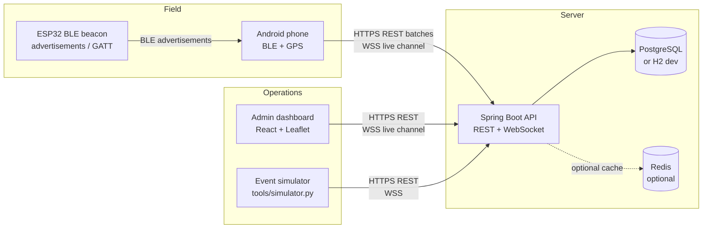
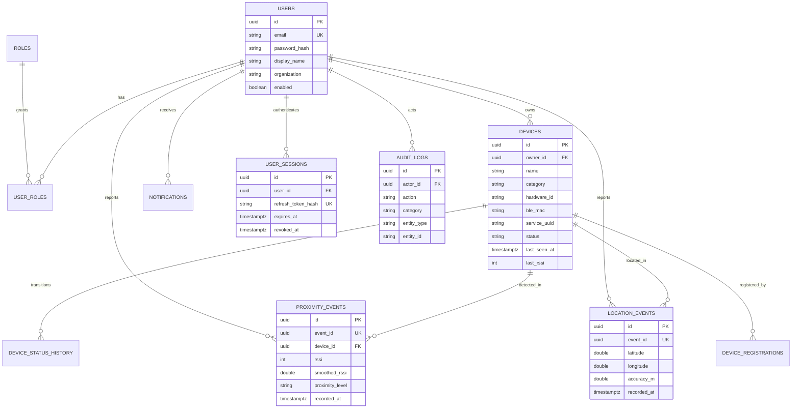
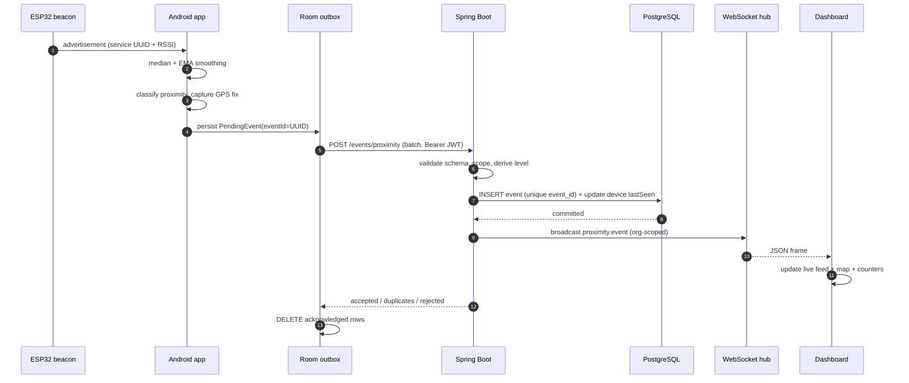

# ProxiLink — System Architecture

## 1. Purpose and scope

ProxiLink correlates two independent positioning signals:

| Signal | Answers | Accuracy |
|---|---|---|
| GPS (FusedLocationProvider) | *Where in the world is the user?* | 5–50 m outdoors, unreliable indoors |
| BLE RSSI | *Is a known device physically near this phone?* | Coarse proximity band, not metric distance |

The system never claims that RSSI is a distance sensor or that GPS works indoors.
Every proximity value in the UI is a **band** (`IMMEDIATE`, `VERY_CLOSE`, `NEARBY`, `FAR`,
`OUT_OF_RANGE`) derived from a smoothed RSSI, with a path-loss distance estimate shown as an
explicit approximation.

## 2. Context diagram



## 3. Layered backend

```
com.proxilink.backend
├── auth          registration, login, refresh rotation, sessions
├── security      JWT filter, principal, RBAC rules, rate limiting
├── device        registered IoT devices, status history, offline monitor
├── event         proximity + location ingestion, idempotency, classifier
├── realtime      WebSocket handshake, session registry, org-scoped fan-out
├── dashboard     overview, live feed, analytics aggregation
├── notification  user notifications generated from events
├── admin         users, settings, audit log, system status
└── common        errors, pagination, audit plumbing
```

Rules:

- Controllers only translate HTTP ↔ DTOs; transactional rules live in services.
- Every query is scoped by `organization` unless the principal holds `ADMIN`.
- Events are append-only. Device `lastSeen`/`status` are denormalized read models updated in the
  same transaction as ingestion.
- Audit log writes are explicit service calls for security-relevant actions, not a blanket AOP log.

## 4. Data model



Full DDL: `backend/src/main/resources/db/migration/V1__init.sql`.
Rationale:

- `event_id` is a client-generated UUID with a unique index — that is the entire offline-sync
  idempotency mechanism. Replaying an outbox never duplicates data.
- `device_status_history` preserves transitions instead of overwriting history.
- `system_settings` is key/value JSON so thresholds can change without redeploying Android.
- Refresh tokens are stored as SHA-256 hashes, never raw.

## 5. Proximity pipeline

```
raw RSSI (-100 … -30 dBm)
   → median of last 5 samples         (kills single-sample spikes)
   → EMA α = 0.3                      (smooth remaining jitter)
   → threshold bands (configurable)   → IMMEDIATE / VERY_CLOSE / NEARBY / FAR / OUT_OF_RANGE
   → log-distance: d = 10^((txPower - RSSI) / (10·n))
```

Defaults: `txPower = -59 dBm @ 1 m`, `n = 2.0` (free space). Walls, bodies, antenna orientation and
2.4 GHz interference make `d` indicative only; the UI labels it as an estimate.

Server-side classification is authoritative: the Android client sends `smoothedRssi`, the backend
recomputes the band from settings, so a tampered client cannot downgrade or upgrade severity.

## 6. Event journey (required end-to-end path)



Failure handling:

- **No network** → WorkManager keeps rows pending, exponential backoff (`10s · 2^n`, capped 1 h),
  network constraint requires connectivity.
- **Server 5xx / timeout** → retry; the idempotent `eventId` makes double delivery harmless.
- **Partial batch rejection** → accepted rows are removed, rejected rows are marked and surfaced in
  the Android network screen instead of retrying forever.
- **Device offline** → scheduled monitor flips `ONLINE/NEARBY` to `OFFLINE` after
  `offlineTimeoutSeconds`, writes status history and broadcasts `device.status`.

## 7. Real-time channel

A single `/ws` endpoint serves browser and Android:

- JWT is validated in the handshake interceptor (query parameter, because the browser WebSocket API
  cannot set an `Authorization` header). Invalid tokens never reach the upgrade.
- Sessions carry `userId`, `organization`, `admin`; the broadcast hub filters per organization.
- Access tokens are 30 minutes; reconnect uses `/auth/refresh`. Production must use `wss://`
  behind TLS termination, and access logs must not capture query strings.
- Native JSON frames instead of STOMP keeps the Android client dependency-free and the protocol
  readable in browser devtools.

## 8. Android architecture

```
ui (Compose, Material 3, dark-first design system)
  ├── screens/ (18 screens, Navigation Compose)
  └── viewmodel/ (StateFlow UI state)
domain
  ├── proximity/ (RssiSmoother, ProximityClassifier, DistanceEstimator)
  └── model/
data
  ├── ble/ (BluetoothLeScanner → callbackFlow, permission-aware)
  ├── location/ (FusedLocationProvider, interval + sharing toggle)
  ├── remote/ (Retrofit API, auth interceptor, OkHttp WebSocket)
  ├── local/ (Room: cached devices, event outbox, tokens via DataStore)
  └── repository/ (single source of truth, offline-first)
service/ (BLE foreground service, sync WorkManager, connectivity observer)
di/ (Hilt modules)
```

Key choices:

- Scanning is explicit and user-started; the foreground service (with visible notification) runs
  only while monitoring is on, respecting Android 14+ foreground-service types.
- MAC addresses are treated as optional: Android 12+ often exposes randomized/placeholder addresses.
  Identity is service UUID + hardware ID + advertised name.
- Maps use osmdroid + OpenStreetMap (no API key, no vendor telemetry).
- Unit-testable core: smoothing/classification are pure Kotlin classes with no Android dependency.

## 9. Security posture

| Control | Implementation |
|---|---|
| Password storage | BCrypt (strength 12) |
| Access token | HMAC-SHA256 JWT, 30 min, roles + org claims |
| Refresh token | 256-bit random, SHA-256 hash at rest, single-use rotation, 14 days |
| Authorization | URL + `@PreAuthorize` RBAC; org-scoped queries |
| Transport | HTTPS/WSS in production (reverse proxy); CORS allow-list |
| Abuse protection | per-IP/per-user token-bucket rate limits, login stricter |
| Location privacy | sharing toggle; explicit permission rationale; no background scan by default |
| Audit | LOGIN_SUCCESS/FAILURE, REGISTER, DEVICE_*, SETTINGS_UPDATE, USER_UPDATE with IP/UA |
| Secrets | env vars only; dev JWT secret generated at startup if unset |
| Retention | documented policy + admin setting (`dataRetentionDays`) |

## 10. Deployment topology

```
docker compose
├── postgres:16        (persistent volume)
├── redis:7            (optional cache profile)
├── backend            (JVM 21, prod profile, healthcheck)
└── dashboard          (nginx static build + reverse proxy /api and /ws)
```

Local zero-dependency mode: `./gradlew bootRun` (H2 file DB) + `npm run dev` (Vite) +
`python tools/simulator.py`. This is the mode verified on the development machine; see
`documentation/test-report.md` for exactly what was and was not exercised (notably: no physical
Android handset or BLE beacon was available).
