# ProxiLink — Database design

Schema source of truth: `backend/src/main/resources/db/migration/`
(`V1__init.sql`, `V2__seed.sql`). Hibernate runs with `ddl-auto: none` in
development/tests and `validate` in production, so Flyway owns every change.

Supported databases:

| Environment | URL |
| --- | --- |
| Development / tests | H2 2.3, `MODE=PostgreSQL` (file or in-memory) |
| Production | PostgreSQL 16 |

## Entity-relationship diagram

```mermaid
erDiagram
    ROLES ||--o{ USER_ROLES : grants
    USERS ||--o{ USER_ROLES : has
    USERS ||--o{ USER_SESSIONS : owns
    USERS ||--o{ DEVICES : registers
    USERS ||--o{ PROXIMITY_EVENTS : reports
    USERS ||--o{ LOCATION_EVENTS : reports
    USERS ||--o{ NOTIFICATIONS : receives
    USERS ||--o{ AUDIT_LOGS : acts
    USERS ||--o{ SYSTEM_SETTINGS : updates
    DEVICES ||--o{ DEVICE_REGISTRATIONS : records
    DEVICES ||--o{ DEVICE_STATUS_HISTORY : transitions
    DEVICES ||--o{ PROXIMITY_EVENTS : observed_as
    DEVICES ||--o{ LOCATION_EVENTS : associated_with

    ROLES {
        uuid id PK
        varchar name UK
    }
    USERS {
        uuid id PK
        varchar email UK
        varchar password_hash
        varchar display_name
        varchar organization
        boolean enabled
        timestamptz created_at
        timestamptz updated_at
        timestamptz last_login_at
    }
    USER_ROLES {
        uuid user_id PK,FK
        uuid role_id PK,FK
    }
    USER_SESSIONS {
        uuid id PK
        uuid user_id FK
        varchar refresh_token_hash UK
        varchar device_label
        timestamptz expires_at
        timestamptz revoked_at
    }
    DEVICES {
        uuid id PK
        uuid owner_id FK
        varchar organization
        varchar name
        varchar device_type
        varchar category
        varchar hardware_id
        varchar ble_mac
        varchar service_uuid
        varchar status
        boolean active
        timestamptz last_seen_at
        int last_rssi
        varchar last_proximity
        double last_latitude
        double last_longitude
        double last_accuracy_m
        timestamptz last_location_at
        text metadata
    }
    DEVICE_REGISTRATIONS {
        uuid id PK
        uuid device_id FK
        uuid registered_by FK
        varchar method
        timestamptz registered_at
    }
    DEVICE_STATUS_HISTORY {
        uuid id PK
        uuid device_id FK
        varchar status
        varchar reason
        timestamptz changed_at
    }
    PROXIMITY_EVENTS {
        uuid id PK
        uuid event_id UK
        varchar organization
        uuid user_id FK
        uuid device_id FK
        varchar device_name
        varchar ble_mac
        int rssi
        double smoothed_rssi
        varchar proximity_level
        double estimated_distance_m
        double latitude
        double longitude
        double accuracy_m
        timestamptz recorded_at
        timestamptz received_at
        text metadata
    }
    LOCATION_EVENTS {
        uuid id PK
        uuid event_id UK
        varchar organization
        uuid user_id FK
        uuid device_id FK
        double latitude
        double longitude
        double accuracy_m
        double speed_mps
        double altitude_m
        varchar source
        timestamptz recorded_at
        timestamptz received_at
        text metadata
    }
    NOTIFICATIONS {
        uuid id PK
        uuid user_id FK
        varchar type
        varchar title
        varchar body
        boolean is_read
        timestamptz created_at
        text metadata
    }
    AUDIT_LOGS {
        uuid id PK
        uuid actor_id FK
        varchar action
        varchar category
        varchar entity_type
        varchar entity_id
        varchar ip
        varchar user_agent
        text details
        timestamptz created_at
    }
    SYSTEM_SETTINGS {
        varchar setting_key PK
        text setting_value
        uuid updated_by FK
        timestamptz updated_at
    }
```

## Tenancy model

`organization` is a denormalized string copied onto devices and both event tables.
This keeps authorization checks index-friendly and preserves the organization when
a device is deleted. Application rules:

- Non-admin reads/writes are filtered by `organization = principal.organization`.
- Administrators may query across organizations; admins creating devices may
  specify a target organization explicitly.
- A device's `hardware_id` is unique **per organization**, not globally, so two
  tenants can each own an `esp32-001`.

## Table notes

### `users`, `roles`, `user_roles`, `user_sessions`

- Passwords: BCrypt(12), column length 100.
- Role rows are seeded with fixed UUIDs (`USER`, `ADMIN`) in `V2__seed.sql`.
- Refresh tokens are never stored in plaintext: `refresh_token_hash` holds the
  SHA-256 hex digest; rotation revokes the previous row.
- `last_login_at` is updated by a dedicated modifying query so login does not
  require a long transaction.
- Retention: sessions older than 30 days are deleted by the retention job.

### `devices`

- `status` is derived from observations and the staleness monitor; `active`
  controls whether events are accepted. `DELETE /devices/{id}` sets
  `active=false`, status `INACTIVE` and keeps history.
- Last-known state (`last_rssi`, `last_proximity`, coordinates) is denormalized
  for the live dashboard and map; the history lives in the event tables.
- Metadata is JSON text validated/serialized by the application.
- Indexes: organization, status, owner and unique `(organization, hardware_id)`.

### `device_registrations`, `device_status_history`

Append-only audit of how a device entered the system and how its status changed.
Status history is written on registration, activation/deactivation and proximity
transitions; the staleness monitor writes OFFLINE transitions.

### `proximity_events`

- `event_id` is the client-generated UUID and is unique; duplicate uploads are
  counted as duplicates and never inserted twice.
- `proximity_level` and `estimated_distance_m` are recomputed by the server from
  `smoothed_rssi ?? rssi` using the current thresholds.
- `recorded_at` is the device clock, clamped to at most five minutes in the future;
  `received_at` is server time.
- Indexes support organization/time, device/time and level/time queries.

### `location_events`

- Latitude/longitude are required and validated to ±90/±180.
- `source` defaults to `GPS`; the schema leaves room for future sources.
- Indexes: organization/time and user/time.

### `notifications`

Created when a device crosses from far/out-of-range/none into a near band, and
owned by the device owner. `is_read` supports unread counts.

### `audit_logs`

Security-sensitive actions are written in a separate transaction so failed
logins and rolled-back operations are still recorded. The actor FK uses
`ON DELETE SET NULL` so deleting an account does not erase the trail.

### `system_settings`

Key/value store for runtime configuration:

| Key | Default |
| --- | --- |
| `proximity.thresholds` | `{"immediate":-50,"veryClose":-65,"nearby":-80,"far":-95}` |
| `location.intervalSeconds` | `30` |
| `scan.intervalSeconds` | `10` |
| `device.offlineTimeoutSeconds` | `300` |
| `data.retentionDays` | `90` |

Updates validate threshold ordering and are audited (`SETTINGS_UPDATE`).

## Retention and maintenance

`RetentionJob` runs daily at 03:30:

1. Deletes proximity and location events older than `data.retentionDays` in
   batches.
2. Deletes sessions expired more than 30 days ago.
3. Writes a `RETENTION_PURGE` audit entry with the removed counts.

`DeviceStatusMonitor` runs every 60 seconds and marks ONLINE/NEARBY devices
OFFLINE when `last_seen_at` is older than `device.offlineTimeoutSeconds`,
recording history and broadcasting `device.status`.

## Production notes

- Use PostgreSQL with `DATABASE_URL`, `DATABASE_USER`, `DATABASE_PASSWORD`,
  `DATABASE_DRIVER=org.postgresql.Driver`, `JPA_DDL_AUTO=validate`.
- Run Flyway on application startup (default) or as a separate migration step;
  never edit an applied migration.
- Back up with `pg_dump`; the event tables are the largest and can be archived per
  retention policy.
- Redis is optional and disabled by default; Caffeine caching is used for settings.
