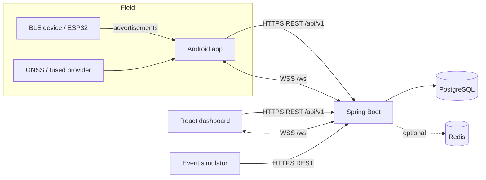
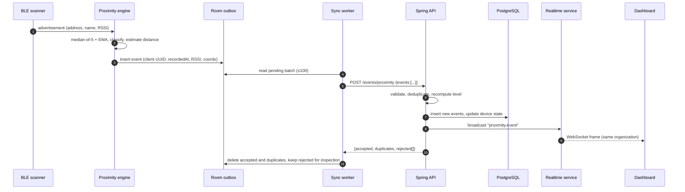

# ProxiLink — Networking and communication design

This document describes how bytes move between the Android client, the backend,
the dashboard and the optional beacon. The authoritative payload shapes live in
[`api-contract.md`](api-contract.md).

## 1. Topology



- All API traffic uses JSON. Timestamps are ISO-8601 UTC (`2026-11-07T13:55:00Z`).
- IDs are UUID strings.
- Production requires HTTPS and WSS; cleartext is allowed only in the Android
  debug build and only for `10.0.2.2`, `localhost` and LAN emulator hosts (see
  `network_security_config.xml`).
- The dashboard is origin-relative: it calls `/api/v1` and `/ws` on its own host,
  and nginx (or the Vite dev server) proxies those paths to the backend. This
  avoids CORS in production and keeps cookies out of the picture.

## 2. Authentication over the wire

1. `POST /api/v1/auth/login` returns `{accessToken, refreshToken, expiresInSeconds, user}`.
2. REST calls send `Authorization: Bearer <accessToken>`.
3. `POST /api/v1/auth/refresh` exchanges the refresh token for a new pair. The old
   refresh token is revoked in the same transaction; replay returns `401`.
4. Access tokens last 30 minutes by default; refresh tokens 14 days.
5. WebSocket authentication uses `GET /ws?token=<accessToken>` because browsers
   cannot set an `Authorization` header on the WebSocket handshake. The token is
   validated before the upgrade; failures return HTTP 401 and no socket is opened.
6. Tokens are never logged or placed in URLs other than the WebSocket handshake.
   Reverse proxies must not log query strings for `/ws` in production.

## 3. Proximity event journey



The same path applies to location events (`/events/location`, type
`location.event`). Device status changes are broadcast as `device.status`;
notifications as `notification`.

## 4. REST conventions

| Concern | Behaviour |
| --- | --- |
| Base path | `/api/v1` |
| Success | `200` for reads/updates, `201` for device registration and account creation, `204` for logout/delete/mark-read |
| Validation | `400 VALIDATION_FAILED` with a `violations` map keyed by field |
| Auth | `401 UNAUTHORIZED` / `401 INVALID_CREDENTIALS` / `401 INVALID_REFRESH_TOKEN` |
| Authorization | `403 FORBIDDEN`, `403 DEVICE_FORBIDDEN`, `403 ACCOUNT_DISABLED` |
| Missing data | `404 DEVICE_NOT_FOUND` / `404 USER_NOT_FOUND` (also used for cross-tenant reads) |
| Conflicts | `409 EMAIL_TAKEN`, `409 HARDWARE_ID_TAKEN` |
| Business rules | `422 INVALID_THRESHOLDS`, `422 SELF_DEMOTE`, `422 SELF_DISABLE` |
| Rate limit | `429 RATE_LIMITED` |
| Server error | `500 INTERNAL_ERROR` with no stack trace |

All errors use one envelope:

```json
{
  "timestamp": "2026-11-07T13:55:00Z",
  "status": 400,
  "error": "Bad Request",
  "code": "VALIDATION_FAILED",
  "message": "Request validation failed",
  "path": "/api/v1/devices"
}
```

Pagination is `?page=0&size=20` and returns
`{items, page, size, totalElements, totalPages}`. Page size is capped at 100;
event batches are capped at 500.

## 5. Idempotency and ordering

- The client generates a UUID per observation (`eventId`) before it is queued.
- The database has a unique constraint on `event_id`; the ingest service checks
  both in-request duplicates and existing rows.
- Retries therefore cannot create duplicate events. The response reports
  `accepted`, `duplicates` and `rejected[{eventId, reason}]`.
- Events are append-only. The server clamps `recordedAt` values more than five
  minutes in the future to server time, which prevents clock-skewed clients from
  poisoning "latest event" queries.
- Ordering is by `recordedAt` for display; ingestion order is irrelevant.

## 6. Offline-first behaviour

Android stores events in Room before any network call. The sync worker:

1. Reads pending rows in creation order.
2. Posts a batch with a request timeout (15 s connect / 20 s read).
3. On success, deletes accepted/duplicate rows and records rejected reasons.
4. On `401`, refreshes the access token once and retries.
5. On `429`/`5xx`/network failure, applies exponential backoff with jitter and
   schedules a retry via WorkManager (network-connected constraint).
6. Never drops an event after a transport failure; storage is bounded by
   retention rules, not by connectivity.

The simulator mirrors this behaviour in memory so demos survive a backend restart.

## 7. WebSocket protocol

- Endpoint: `ws://host:8080/ws?token=<accessToken>` (WSS in production).
- Server frames are JSON: `{ "type": "...", "payload": { ... } }`.

| Type | Payload |
| --- | --- |
| `hello` | `sessionId`, `userId`, `serverTime` |
| `proximity.event` | Full proximity event DTO |
| `location.event` | Full location event DTO |
| `device.status` | `deviceId`, `status`, `lastSeenAt`, `lastRssi` |
| `notification` | Notification DTO |
| `pong` | Empty; reply to client `{"type":"ping"}` |

Fan-out rules:

- Administrators receive every organization's frames.
- Other users receive frames whose `organization` matches their own, plus
  notifications addressed to their user id.
- Disconnected or failing sessions are removed; clients reconnect with
  exponential backoff (1 s → 30 s), re-authenticating first if the access token
  has expired.
- The server sends `hello` immediately after registration, so clients can show a
  connected state without polling.

## 8. Timeouts, retries and backoff

| Operation | Timeout | Retry policy |
| --- | --- | --- |
| Login / refresh | 15 s | 2 attempts, no retry on 4xx |
| Device queries | 15 s | 2 attempts |
| Event upload | 20 s | Exponential backoff, WorkManager, unlimited while outbox non-empty |
| WebSocket connect | 10 s | Exponential backoff with jitter, up to 30 s |

Retries are always safe because reads are idempotent and writes carry client UUIDs.

## 9. Security controls at the network edge

- HTTPS/WSS terminated by nginx or the platform load balancer; HSTS recommended.
- CORS allow-list (`CORS_ALLOWED_ORIGINS`) is explicit; WebSocket origins are
  checked separately (`WS_ALLOWED_ORIGINS`, default `*` only for local demos).
- Per-IP token buckets: 240 requests/minute generally, 10/minute for login,
  registration and refresh.
- Request size limits and DTO validation reject oversized or malformed payloads.
- Reverse proxies should forward `X-Forwarded-For` only from trusted hops; the
  rate limiter trusts the first address in that header.
- JWT secret must be supplied via environment (≥ 32 bytes). With no secret the
  development build generates an ephemeral key and logs a warning; restarting
  invalidates all tokens.

## 10. Failure modes

| Failure | Client behaviour | Server behaviour |
| --- | --- | --- |
| Backend down | Events queue in Room; UI shows offline state | n/a |
| Token expired | Refresh once, retry; otherwise sign out | 401 |
| Refresh replay | Sign out and require login | 401, session revoked |
| Duplicate upload | Batch response reports duplicates | Unique constraint + duplicate counter |
| Device in another organization | Event rejected with `device_not_accessible` | No data written |
| Inactive device | Event rejected with `device_inactive` | No data written |
| Invalid coordinates/RSSI | Rejected locally before upload | 400 validation |
| WebSocket drop | Reconnect with backoff; REST polling fallback | Session removed from registry |
| Clock skew | Server clamps future timestamps | `recordedAt = now` when > now + 5 min |
